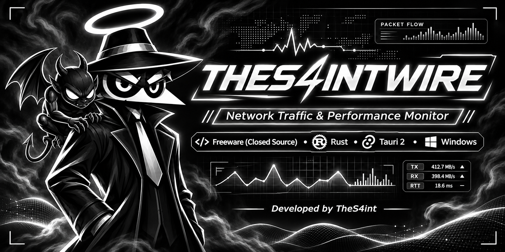

# THES4INTWIRE
**Network Traffic · Browser Intelligence · Threat Intelligence for Windows**  
*Every Packet Tells a Story.* — by **TheS4int**

   

THES4INTWIRE is a Windows desktop network and security monitor built with Rust and Tauri 2. **Freeware, not open source:** this public repository contains documentation, artwork and a distributable browser extension package; the desktop application's source code stays private.

**[Download the latest release](../../releases/latest)** · [Changelog](CHANGELOG.md) · [Browser setup](docs/BROWSER-SETUP-DE.md) · [Security](SECURITY.md)

## Features (v1.24)
- **Live networking:** download/upload speed, adapter selection, RX/TX packets, historical charts, mini-window, system tray.
- **Processes & connections:** local processes, PIDs, TCP/UDP endpoints, ETW-based process/connection traffic (subject to Windows ETW permissions and event availability).
- **Network intelligence:** optional PTR reverse DNS, RDAP network registration, process executable metadata.
- **Browser Intelligence:** optional local browser bridge for Chrome, Edge, Brave, Opera and Firefox; open tabs, titles, URL origins and observable tab transfer counters. Tor tabs are not collected.
- **Threat Intelligence:** local IOC/IP/CIDR matching; manual online IP reputation via VirusTotal and AbuseIPDB (API keys required), report counts, confidence data and heuristic prioritization.
- **Neon / Noir Neon** appearance modes.

## Windows installation
**Portable:** Download `THES4INTWIRE-v1.24.0-Windows-x64-Portable.zip` from the GitHub release when available, extract and run `thes4intwire.exe`.  
**Installer (optional):** Download the NSIS setup EXE when provided.

Windows 11 x64 is the primary target. Microsoft Edge WebView2 Runtime is required. Some network measurement features may need elevated privileges or may be unavailable depending on the Windows ETW session state. Unsigned builds can trigger Windows security warnings: inspect the source of the download and hash before running. Respect workplace device policies.

### Browser bridge
The desktop app functions without extensions. For live tab lists and observed transfer data, install the matching bridge from the **separate** `THES4INTWIRE-v1.24.0-Browser-Bridge.zip` release asset. See [setup instructions](docs/BROWSER-SETUP-DE.md) and [traffic measurement limits](docs/TAB-TRAFFIC-DE.md). Chromium variants need the browser debugger permission and may display a browser debugging warning; Firefox has its own installation path. Extension source files are included because the browser loads them directly, **not** because the desktop code is open source.

## Privacy and security
- Local adapter/process monitoring and local IOC matching do not require a cloud account.
- Browser tab titles, normalized addresses and counters are transmitted to a service bound to `127.0.0.1`; browser pairing is required. The bridge requires browser-level permissions. Do not install it on untrusted/shared machines without reviewing permissions.
- **On-demand external lookups:** RDAP/PTR may query external network services or DNS; VirusTotal/AbuseIPDB receive queried public IPs **only** when you initiate those checks. API keys are not persisted by the current desktop version.
- Suspicious ratings are **signals**, not proof of maliciousness. No match is **not proof of safety**. The 0–100 indicator is a heuristic, not a malware probability.
- Browser transfer statistics are **observed browser-side bytes**, not full TCP/TLS on-wire usage and cannot always be reconciled with ETW process traffic.

More: [reputation setup](docs/REPUTATION-SETUP-DE.md) · [IOC analysis](docs/THREAT-INTELLIGENCE-DE.md).

## Support
Use [Issues](../../issues) to report problems. Do **not** share API keys, private IP inventories, browser URLs, system usernames or other sensitive data. See [SECURITY.md](SECURITY.md) for private security reports.

## Licensing
© 2026 TheS4int. THES4INTWIRE desktop is proprietary freeware; see [LICENSE.txt](LICENSE.txt) for proposed use terms. No desktop source-code license is granted. Third-party dependencies and browser platform components retain their respective licensing obligations. The author should review license terms and third-party notices before publishing.
